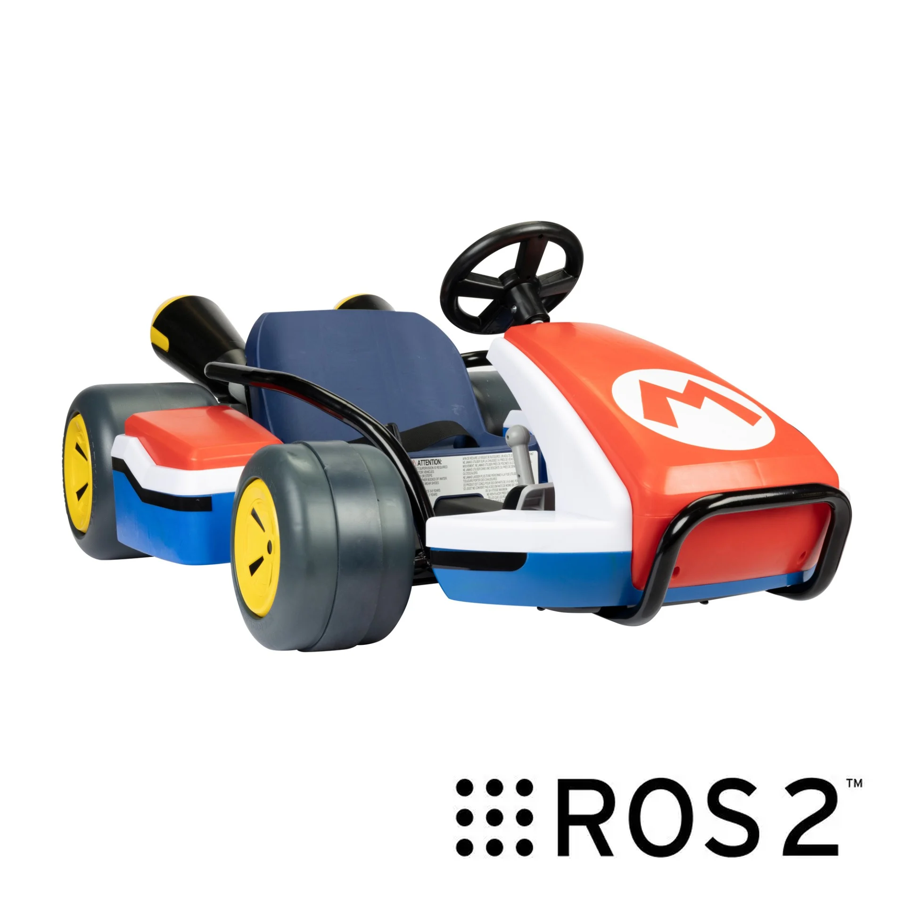

# switchy-op

<p align="center">
  
</p>

switchy-op превращает консоль в пульт телеуправления мобильным роботом. Стики и кнопки позволяют управлять движением и действиями робота, а экран консоли показывает состояние подключения и телеметрию.

Приложение подключается по сети к шлюзу на стороне робота. Раскладку управления можно настроить под его возможности; для отладки предусмотрены симулятор и интеграция с Gazebo через ROS 2.

## Быстрый старт

Нужен [uv](https://docs.astral.sh/uv/); Python 3.14 он поставит сам.

```bash
uv sync
uv run switchy-op demo
```

Демонстрация поднимает шлюз с симулированным роботом и оператора, прогоняет сценарий и проверяет результат (10 проверок). Канал специально «плохой»: часть запросов теряется, часть дублируется.

```
[ 1.52s] link     chaos: duplicated action light
[ 1.52s] gateway  execute light=True
[ 1.52s] gateway  duplicate of action 1 (light): replaying answer
[ 7.28s] gateway  rejected arm_home: estop_active
[10.10s] gateway  link lost (no stream): stopping
[10.60s] check    PASS  robot stopped on its own
...
[11.43s] demo     10 of 10 checks passed
```

## Режимы

| Команда | Что делает |
|---|---|
| `switchy-op demo` | Сценарий со сбоями и самопроверкой |
| `switchy-op gateway` | Шлюз с симулятором на портах 7000 (TCP) и 7001 (UDP) |
| `switchy-op client` | Окно оператора: геймпад или клавиатура, HUD. Нужен `uv sync --extra ui` |

Клавиатура в окне оператора: W/S вперёд и назад, A/D поворот, Space «мёртвая рука» (без неё робот стоит), L свет, H гудок, X (удержание) манипулятор, M аварийная остановка, Esc выход. Геймпад читается как Xbox-раскладка SDL; у контроллеров Nintendo кнопки A/B и X/Y могут оказаться переставленными (таблица в `inputs.py`). С настоящим геймпадом этот путь не проверялся.

## Как устроено

```
Контроллер → Раскладка (профиль) → Клиент ──── TCP (события) ──── Шлюз → Адаптер робота
 (оси, кнопки)  bindings.py         client.py   UDP (скорость)    gateway.py   backend.py
```

- [docs/protocol.md](docs/protocol.md): формат сообщений, надёжность, безопасность, потеря связи.
- `robots/sim.yaml`: что умеет робот (действия, пределы, блокировки). Новое действие добавляется здесь, клиент узнаёт о нём сам.
- `profiles/gamepad.yaml`: какая кнопка что делает.
- `src/switchy_op/backend.py`: интерфейс, который нужно реализовать для настоящего робота (например, поверх ROS 2). Для симулятора это `sim.py`.

## Разработка

```bash
uv run ruff check
uv run ruff format
uv run mypy
```

Автоматических тестов нет: проверкой служит `switchy-op demo`.
